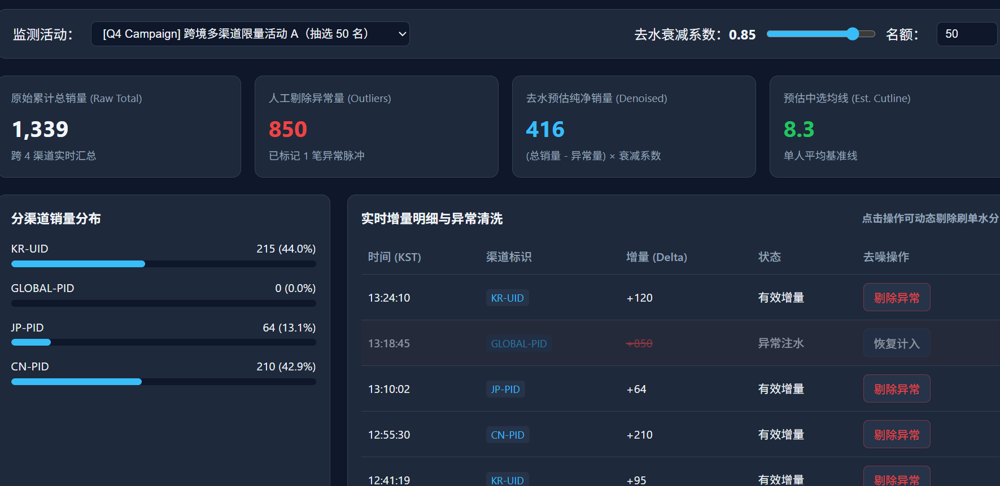

# Multi-Channel Sales Monitoring & Denoising Dashboard

> 跨境多渠道销量实时监测、异常数据去噪与均值预测分析系统

## 系统预览

### 实时监控与去噪分析主看板

## 核心功能与技术架构

- **多渠道聚合与跨时区状态机**
  - 支持韩国站（UID）、国际/中日站（PID）多渠道销量增量（Delta）实时追踪。
  - 内置 KST（UTC+9）时区正则解析器，根据活动截止时间自动驱动生命周期状态流转（进行中 / 即将截止 / 已结束）。
- **双层数据去噪与估值模型（Denoising & Estimation）**
  - **单笔异常剔除（Outlier Tagging）**：支持在明细流中对异常刷单或脉冲订单进行人工打标剔除。
  - **动态衰减系数折算**：支持实时调节去水阈值（`0.01 ~ 1.00`），按 `(总销量 - 异常剔除量) × 衰减系数 / 抽选名额` 实时计算纯净销量与**预估中选均线（Cutline）**。
- **零延迟首屏渲染与静默轮询**
  - 基于 `localStorage` 本地快照缓存机制实现 0ms 首屏直显，配合定时增量同步，兼顾弱网体验与数据实时性。
- **细粒度 RBAC 权限与安全审计**
  - 支持管理员 / 访客双角色鉴权、活动粒度数据隔离、单设备会话互踢（Single-Session Enforcement）及全量操作审计日志（支持 CSV 导出）。

## 技术栈

- **Frontend**: HTML5, CSS3 (CSS Variables / Responsive Grid), Vanilla ES6+
- **Backend & Storage**: Cloudflare Workers (Serverless Edge API) + Cloudflare KV

## 快速部署

1. **前端预览**：直接启用 GitHub Pages（指向 `main` 分支根目录）即可在线访问内置演示模式。
2. **后端部署**：在 Cloudflare Workers 创建项目并绑定名为 `SALES_KV` 的 KV 命名空间，配置环境变量 `ADMIN_USER` 与 `ADMIN_PASS` 后部署 `worker.js`。
